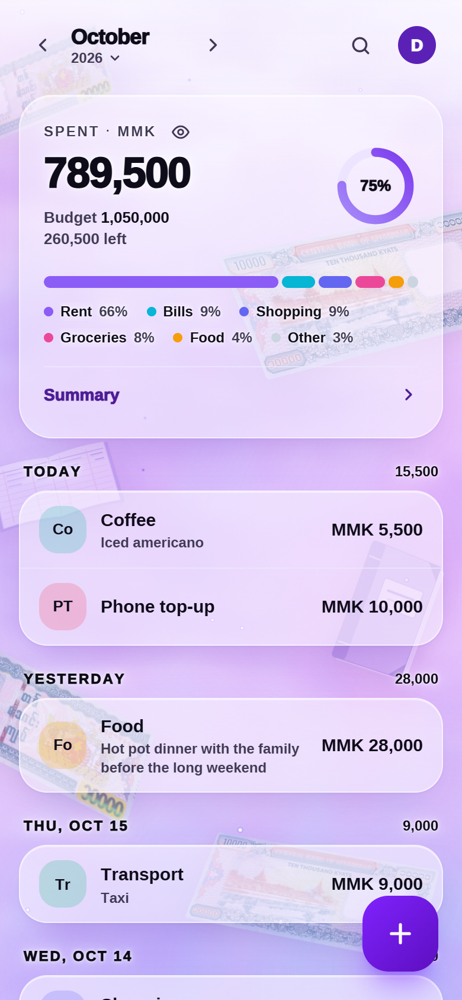
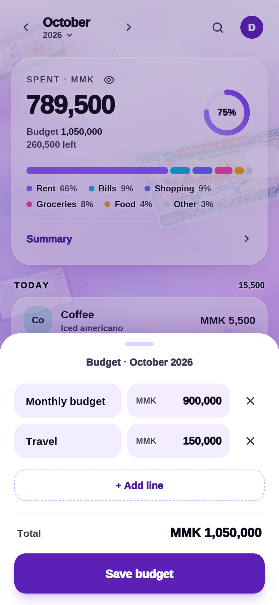
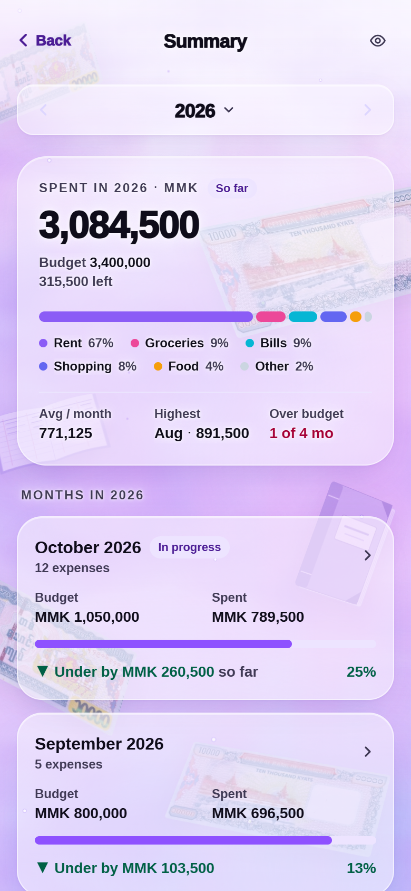

# mithril — offline-first expense tracker

A mobile-first, installable PWA for logging expenses in MMK. The app reads and writes IndexedDB on the device, so it works with no network. When it's online, it syncs with your account in Supabase, so your data follows you to other devices.

<table>
  <tr>
    <td align="center"></td>
    <td align="center"></td>
    <td align="center"></td>
    <td align="center"></td>
  </tr>
  <tr>
    <td align="center"><sub>Home</sub></td>
    <td align="center"><sub>Adding an expense</sub></td>
    <td align="center"><sub>Monthly budget</sub></td>
    <td align="center"><sub>Summary report</sub></td>
  </tr>
</table>

## Stack

- **Next.js 16** (App Router, Turbopack) + **Tailwind CSS v4**
- **Dexie** (IndexedDB) for local data, with live queries through `dexie-react-hooks`
- A hand-written service worker in [`public/sw.js`](public/sw.js) for offline use
- **Supabase**: Auth for accounts, and Postgres tables in their own `mithril` schema for sync ([`supabase/schema.sql`](supabase/schema.sql))
- Deploys to **Vercel**

## Develop

```bash
npm install
cp .env.example .env.local   # then fill in your Supabase URL and publishable key (see "Supabase setup")
npm run dev        # http://localhost:3000 (the service worker is disabled in dev)
npm run build && npm start   # production mode, the service worker is active
```

**On your phone:** `npm run dev` prints the address to open on a phone or tablet on the same Wi-Fi, for example `http://192.168.1.4:3000`. [`next.config.ts`](next.config.ts) allows this PC's local-network addresses automatically, so the app's dev files aren't blocked. **The phone needs a secure address.** Data is encrypted with WebCrypto, which browsers allow only on `https://` or `localhost`. Over plain `http://192.168.x.x` the app shows "Open mithril over HTTPS" instead of the sign-in screen, for `npm run dev` and `npm start` alike. Ways to test on a phone:

- **Android, USB:** in desktop Chrome open `chrome://inspect/#devices` → **Port forwarding** → `3000` → `localhost:3000`, then open `http://localhost:3000` on the phone. Everything works, including the service worker and Install.
- **Android, Wi-Fi:** on the phone open `chrome://flags/#unsafely-treat-insecure-origin-as-secure`, add `http://192.168.x.x:3000`, enable it and relaunch Chrome.
- **iPhone, or anything else:** use the HTTPS deployment (Vercel), or an HTTPS tunnel to this PC such as `cloudflared tunnel --url http://localhost:3000`.

**Where the app runs:** `npm run dev` shows the app in any browser. In production it runs as the installed app. In a phone's browser it shows an install screen: an **Install app** button on Android, or Add to Home Screen steps on iOS. A desktop browser shows "Open this in your mobile browser" with a link to copy. Both screens have a **Use the web version** link that opens the app right in the tab. A reload or Sign out goes back to the screen. To try a production build on a PC, install it from the install icon in the Chrome or Edge address bar; the installed window shows the app.

To test offline mode, run `npm run build && npm start`, install the app as above, and open it once. Then go to DevTools → Network → **Offline** and reload.

## Project map

| Path | What |
| --- | --- |
| `app/page.tsx` | Prerendered shell. After hydration it shows the app (in dev, or when installed), or else the install / open-on-mobile screen |
| `components/InstallScreen.tsx` | Install screen for phone browsers and "Open this in your mobile browser" for desktops |
| `components/AuthGate.tsx` | Login screen until someone is signed in, unlock screen until their data is unlocked, then their `<Tracker />` |
| `lib/vault.ts` | The signed-in user's data keys (in memory only): password/PIN unlock, lock, auto-lock |
| `lib/crypto.ts` | WebCrypto helpers: key wrapping, sealing fields (AES-GCM), blind indexes (HMAC) |
| `lib/auth.tsx` | `AuthProvider`, `useUser()`, `currentUserId()`, sign in/out. The client is shaped like `supabase.auth` |
| `lib/supabase.ts` | Supabase client (`mithril` schema) and the auth adapter that keeps offline launches signed in |
| `lib/authSession.ts` | Where supabase-js keeps the session: sealed with the user's key, readable only while unlocked |
| `lib/clock.ts` | `updatedAt` stamps, corrected to the server's clock |
| `lib/sync.ts` | Background two-way sync with Supabase, and the sync status shown in Account |
| `supabase/schema.sql` | Server tables, RLS and triggers. Paste it into the Supabase SQL editor |
| `supabase/migrations/` | Changes to the server schema for projects set up earlier, one dated file each |
| `components/Tracker.tsx` | The screen: month header, summary card, list, sheets |
| `lib/db.ts` | Dexie schema (`expenses`, `labels`, `prefs`) and its migrations |
| `lib/repo.ts` | **The only module that touches storage.** CRUD, label upsert, live queries, budget, and the sync helpers, all scoped to the signed-in user |
| `lib/useInstallPrompt.ts` | Install state for `components/InstallScreen.tsx` (native prompt on Android, Add to Home Screen steps on iOS) and the in-memory "web version" choice |
| `app/manifest.ts` | Web App Manifest |
| `components/GalaxyBackdrop.tsx` | Fixed background behind every screen: galaxy, plus still 10,000 kyat notes and ledgers (`components/MoneyFlutter.tsx`, scans in `public/notes/`) |
| `public/sw.js` | Offline caching. Bump `VERSION` to purge old caches. |
| `scripts/seed-sample.mjs` | `npm run seed -- <email>`: adds ~2 months of demo spending to one account in Supabase |
| `scripts/generate-icons.mjs` | Regenerates `public/icons/*` with `node scripts/generate-icons.mjs` |

## Data model

```ts
Expense { id: uuid, userId, box /* sealed { amount: int MMK, note } */, labelId, date: "YYYY-MM-DD",
          createdAt, updatedAt, deletedAt? /* soft delete */ }
Label   { id: uuid, userId, box /* sealed { name } */, key /* HMAC of the normalised name, unique per user */,
          color, useCount, lastUsedAt, deletedAt? /* soft delete */ }
Pref    { userId, key: "budget:YYYY-MM" | "privacy" | "autoLock" | "pinOffer" | "sync:*", value | box, updatedAt, deletedAt? }
        // primary key [userId, key]; budgets sealed; a removed budget is a tombstone (deletedAt); only budgets sync
BudgetLine { id: uuid, name, amount: int /* MMK */ }  // a budget:YYYY-MM value is BudgetLine[]
Vault   { userId, kind: "password" | "pin", salt, iterations, iv, wrapped, failedAttempts }  // primary key [userId, kind]; never synced
```

**Budgets** are per month and never carry over. A month's budget is a list of named lines ("Monthly budget", "New extra", …), and its total is their sum. The first line of a new month's budget is named "Monthly budget". Before v6 of the schema, a budget was one number and could be set for every month (`budget:default`). The v6 upgrade turns each number into one "Monthly budget" line and writes the old every-month value out to each month it used to cover.

**Labels** are free text and upserted on save. `prepareLabel()` normalises the name (trim, collapse spaces, lower-case), so `"coffee "`, `"Coffee"` and `"COFFEE"` all resolve to one label, and that label's usage count goes up. The picker suggests labels in most-recently-used order, and a label stops being suggested once no live expense uses it.

**Account → Labels** lists every label with how many expenses use it. Renaming a label renames it on every expense. Renaming it to the name of another label offers to merge them: its expenses move to that label, and it's deleted. A label can be deleted only while no live expense uses it. A delete is soft (`deletedAt`), and the row keeps its key, so the name stays unique. Typing a deleted label's name again, or undoing the delete of one of its expenses, brings it back.

## Sign-in

Accounts live in Supabase Auth, and there's no registration: add users in the Supabase dashboard. Signing in needs a connection. After that the app opens offline too, and goes straight to the unlock screen.

Every row carries the `userId` of its owner, and every query in `lib/repo.ts` filters by it, so each account sees only its own expenses, labels, budgets and privacy setting. On the server, row-level security does the same. Data stays on the device after sign-out. Rows saved before sign-in existed are adopted by the first account that signs in on that device. Data saved under the old demo accounts isn't carried over, because those user ids don't exist in Supabase.

## Encryption at rest

Amounts, notes, label names and budgets are encrypted in IndexedDB with a per-user AES-GCM key, so someone who opens DevTools, or copies the browser profile, sees only ciphertext. Ids, dates, timestamps and flags stay readable for indexing and sync, so they show *when* you spent, but not how much or on what.

- The key is stored only wrapped by your password (PBKDF2-SHA-256, 600k iterations) and, optionally, by a 6-digit PIN. Once unlocked, it lives in memory only.
- Signing in unlocks. A reload, Sign out, **Lock now** or auto-lock (1, 5 or 15 min in the background or left idle on screen, set in Account) locks it again. Locking one tab locks every tab.
- Your Supabase session is stored encrypted with the same key, so a locked device, or a copy of its browser data, holds no token that could read your account on the server. Signing out ends the session on the server; offline, or from the lock screen, that happens the next time you unlock online on that device.
- After a password unlock, the app offers to set a PIN for quicker unlocks. The account menu can set up, change or remove it.
- A PIN keeps out someone who picks up your phone. It can be brute-forced offline by someone who copies the database; your password is the stronger lock. 5 wrong PINs remove the PIN, counted one at a time across tabs.
- Encrypted values are padded to a fixed size (64, 128, 256, … bytes), so their size doesn't show how many digits an amount has or how long a note is.
- Data saved before encryption (or before padding) existed is encrypted, or re-padded, the first time its owner unlocks.
- A Content-Security-Policy keeps the page from loading or sending anything to hosts other than your Supabase project.
- **What the server sees:** sync sends the opened values, so Supabase stores amounts, notes, label names and budgets in plain, protected by row-level security. Encryption here protects the copy on the device.
- If your password is changed or reset in Supabase, the next sign-in on a device can't open that device's old copy. The app clears it, makes new keys and pulls your data back from the server. Changes that hadn't synced yet are lost.

## Supabase setup

1. Create a Supabase project.
2. In the SQL editor, paste and run [`supabase/schema.sql`](supabase/schema.sql). It creates the `mithril` schema with `expenses`, `labels` and `prefs`, row-level security, and the trigger that keeps the newest edit.
3. **Project Settings → Data API → Exposed schemas:** add `mithril`. Until you do, sync fails with "Invalid schema".
   A new project doesn't need anything from `supabase/migrations/`. A project set up earlier runs the migration files added since its setup, oldest first.
4. **Authentication → Sign In / Providers:** turn off new sign-ups. Then go to **Authentication → Users → Add user** and add each account with "Auto confirm" on.
5. Copy `.env.example` to `.env.local` and set `NEXT_PUBLIC_SUPABASE_URL` and `NEXT_PUBLIC_SUPABASE_PUBLISHABLE_KEY`. Find them under Project Settings → API Keys; the legacy anon key also works.

**Demo data:** `npm run seed -- someone@example.com` looks up that account by email and stops if there's none. Otherwise it shows what it will add and asks before writing: about 2 months of spending (the 1st of last month to today) across everyday labels, plus monthly bills. Labels the account already has are reused. Add `--yes` to skip the question. It needs `SUPABASE_SECRET_KEY` (the secret or legacy service_role key) in `.env.local`. That key bypasses row-level security, so keep it on your machine: never prefix it with `NEXT_PUBLIC_` and never add it to Vercel. The rows are ordinary expenses, so the app syncs them on its next pull, and you delete them in the Table Editor.

**How sync works:** the app syncs when you unlock, when it comes back online or into view, every 5 minutes, and a moment after each change. It pulls what the server stamped since its last pull, then pushes rows edited since its last push. If the same row was edited in two places, the edit with the newer `updatedAt` wins. Stamps follow the server's clock (`mithril.server_time()`), and an edit is always stamped later than the version it replaced, so a phone whose clock is wrong can't lose its edits or freeze a row. Rows stamped in the future by such a phone are re-stamped on its next sync, and the server won't store a stamp more than 5 minutes ahead. The sync state ("Synced at 3:42 PM", "Offline", …) shows in the Account sheet.

## Deploy

Push the repo to GitHub, then import it in Vercel. [`vercel.json`](vercel.json) pins the framework, the install and build commands, and the region (`sin1`, Singapore, the closest to Myanmar). The app is prerendered, so the region only matters for anything server-side added later. Security headers live in `next.config.ts`, not here. Set `NEXT_PUBLIC_SUPABASE_URL` and `NEXT_PUBLIC_SUPABASE_PUBLISHABLE_KEY` in the project's environment variables. They're read at build time, for the client and for the CSP, so redeploy after changing them.
